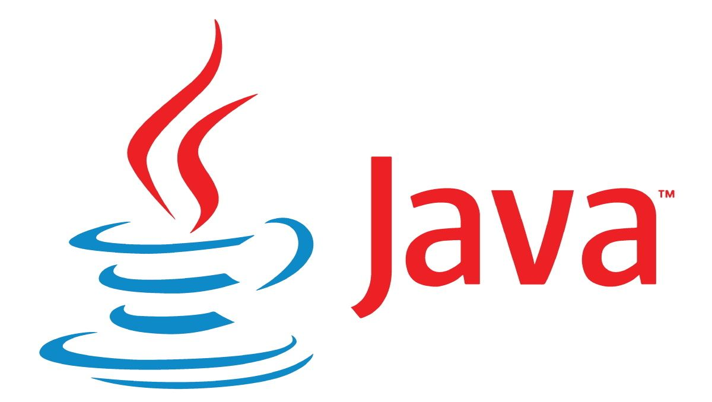

# Java <Badge type="tip" text="Java" />

---



Java est un langage orienté objet, fortement typé et compilé. Le code est exécuté par la machine virtuelle Java (JVM), ce qui permet au même programme de tourner sur Windows, macOS et Linux.

Je l'ai appris chez **Jobtrek** en réalisant un jeu de morpion en ligne de commande.

## Concepts appris

### Les classes et les objets

En Java, tout le code est organisé en classes. Une classe regroupe des données (attributs) et des actions (méthodes).

```java
public class Player {
    private final String name;
    private final char symbol;

    public Player(String name, char symbol) {
        this.name = name;
        this.symbol = symbol;
    }

    public char getSymbol() {
        return symbol;
    }

    public String getName() {
        return name;
    }
}
```

### Les tableaux à deux dimensions

La grille du morpion est un tableau de 3 lignes et 3 colonnes. Des boucles imbriquées permettent de la parcourir.

```java
char[][] board = new char[3][3];

for (int row = 0; row < 3; row++) {
    for (int col = 0; col < 3; col++) {
        board[row][col] = '-';
    }
}
```

### Lire les saisies de l'utilisateur

La classe `Scanner` lit ce que le joueur tape dans le terminal.

```java
import java.util.Scanner;

Scanner scanner = new Scanner(System.in);
System.out.print("Ligne (0-2) : ");
int row = scanner.nextInt();
```

### Les conditions de victoire

Une méthode vérifie si un joueur a aligné trois symboles sur une ligne, une colonne ou une diagonale.

```java
boolean hasWon(char[][] board, char s) {
    for (int i = 0; i < 3; i++) {
        if (board[i][0] == s && board[i][1] == s && board[i][2] == s) return true;
        if (board[0][i] == s && board[1][i] == s && board[2][i] == s) return true;
    }
    return (board[0][0] == s && board[1][1] == s && board[2][2] == s)
        || (board[0][2] == s && board[1][1] == s && board[2][0] == s);
}
```

## Mes projets en Java

- [Java Tic-Tac-Toe](../projects/java-tic-tac-toe.md)
