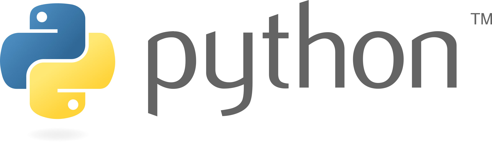

# Python <Badge type="tip" text="Python" />

---



Python est un langage de programmation libre, polyvalent et très lisible. Il est utilisé pour le développement web, l'analyse de données, l'automatisation et l'intelligence artificielle.

C'est le langage que j'utilise le plus chez **Compassion Suisse**, car tout le back-end d'[Odoo](../framework/odoo.md) est écrit en Python. Je l'ai utilisé pour corriger des bugs, ajouter des fonctionnalités, sécuriser des accès et migrer des modules vers Odoo 18.

## Concepts appris

### Les modèles et les champs Odoo

Dans Odoo, chaque table de la base de données est représentée par une classe Python. Les champs définissent les colonnes et les relations entre les modèles (`many2one`, `many2many`…).

```python
from odoo import fields, models


class Event(models.Model):
    _name = "my.event"
    _description = "Événement"

    name = fields.Char(required=True)
    date = fields.Date()
    # many2many : plusieurs employés peuvent être notifiés
    notify_user_ids = fields.Many2many("res.users", string="Employés notifiés")
```

J'ai par exemple transformé un champ `many2one` en `many2many` pour que plusieurs employés soient notifiés des inscriptions au Muskathlon.

### Les champs calculés

Un champ calculé (`compute`) est mis à jour automatiquement à partir d'autres champs. Je l'ai utilisé pour calculer la progression d'un traducteur vers son prochain badge.

```python
from odoo import api, fields, models


class Translator(models.Model):
    _inherit = "res.partner"

    translation_count = fields.Integer()
    badge_threshold = fields.Integer(default=10)
    progress = fields.Float(compute="_compute_progress")

    @api.depends("translation_count", "badge_threshold")
    def _compute_progress(self):
        for partner in self:
            ratio = partner.translation_count / (partner.badge_threshold or 1)
            partner.progress = min(ratio, 1.0) * 100
```

### La gestion des erreurs

Avec `try` / `except`, on peut intercepter une erreur technique et afficher un message compréhensible à l'utilisateur. C'est ce que j'ai fait pour l'import des lettres scannées et le bouton « Forget me ».

```python
from odoo.exceptions import UserError


def import_letter(self, file):
    try:
        partner = self._find_partner(file)
    except ValueError:
        raise UserError(
            "Le parrain n'a pas été trouvé. Vérifiez la référence écrite sur la lettre."
        )
    return self._create_letter(partner, file)
```

### La sécurité des accès

Il ne faut jamais faire confiance à un identifiant reçu dans une URL. Avant de modifier un enregistrement, on vérifie qu'il appartient bien à l'utilisateur connecté. C'est le principe des corrections IDOR que j'ai réalisées.

```python
from odoo import http
from odoo.http import request


class ProjectController(http.Controller):

    @http.route("/my/project/<int:project_id>/edit", auth="user", website=True)
    def edit_project(self, project_id, **kwargs):
        project = request.env["crowdfunding.project"].browse(project_id)
        # Refuser l'accès si le projet n'appartient pas à l'utilisateur
        if project.project_owner_id != request.env.user.partner_id:
            raise request.not_found()
        return request.render("my_module.project_edit", {"project": project})
```

## Mes projets en Python

- [Analyse du site web (Google Analytics)](../projects/google-analytics-odoo.md)
- [Amélioration des messages d'erreur du scan](../projects/Improve-error-scan.md)
- [Corrections du scan des lettres](../projects/letter-import-fixes.md)
- [Fonction « Forget me »](../projects/forget-me.md)
- [Corrections du back-office Odoo](../projects/odoo-backoffice-fixes.md)
- [Correction des failles IDOR et XSS](../projects/resolve-security-issues.md)
- [Liens Google Maps pour les bureaux terrain](../projects/add-google-maps-link.md)
- [Photos des enfants dans la timeline](../projects/child-picture.md)
- [Migration vers Odoo 18](../projects/odoo-18-migration.md)
- [Correction des données de traduction](../projects/Correct-translation-data.md)
- [Système de badges](../projects/Badges-gamification.md)
