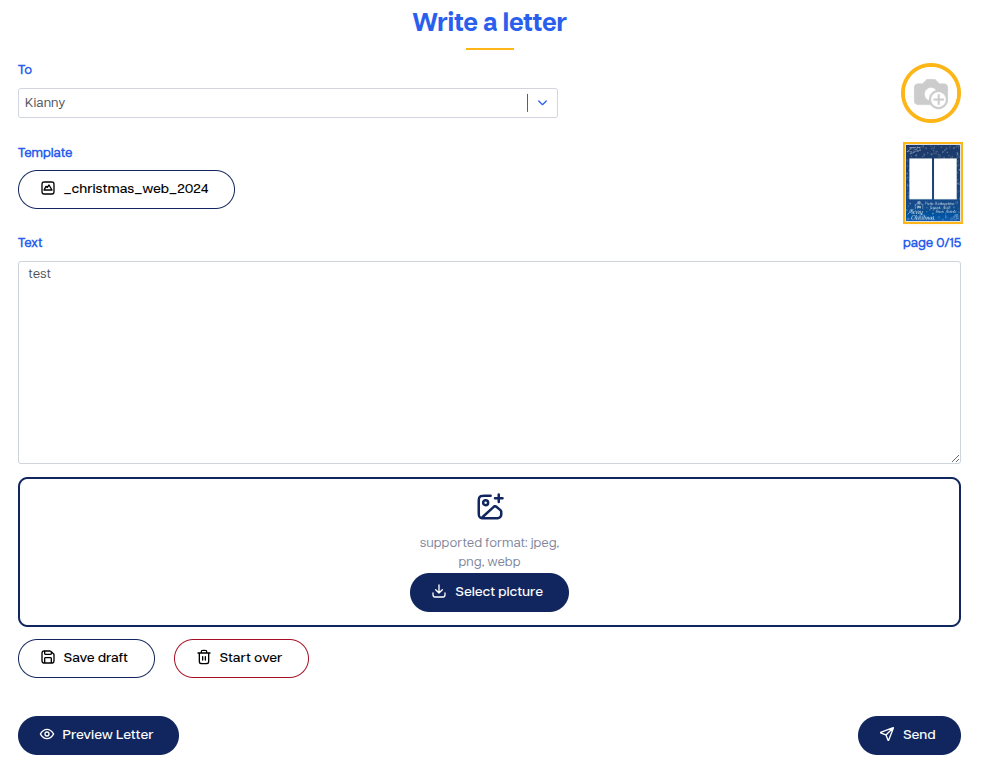

# Page Letters – mycompassion 2.0 <Badge type="tip" text="Frontend" />

- **Technologies :** HTML, CSS, JavaScript, Odoo
- **Date de réalisation :** 07.2025 – 11.2025
- **Durée :** [À compléter]
- **Lieu de réalisation :** Compassion Suisse, Rue Galilée 3, 1400 Yverdon-les-Bains
- **Note :** [À compléter]
- **Compétences opérationnelles acquises :** g1, g2, g5, g6

## Description
L’objectif de ce module est de refondre la page Letters selon le nouveau design de la plateforme *mycompassion 2.0* et d’améliorer l’expérience de rédaction pour les utilisateurs. Le but principal est de permettre la gestion fluide des lettres (rédaction, sauvegarde, visualisation) tout en garantissant une interface moderne, responsive et simple d’utilisation.

**Fonctionnalités principales :**
- **Écrire des lettres** dans une interface entièrement repensée, plus claire et ergonomique.
- **Sauvegarder automatiquement le contenu** (*autosave*) afin d’éviter toute perte de données durant la rédaction.
- **Créer et reprendre des brouillons**, permettant à l’utilisateur de continuer une lettre non finalisée à tout moment.
- **Prévisualiser les lettres** directement depuis la liste, sans quitter la page.
- **Naviguer efficacement** entre les différentes sections grâce à une structure de composants optimisée et responsive.

**Travaux effectués :**
1. **Nouvelle page « Nouvelle lettre » (07.2025) :** refonte de la page selon la maquette Figma du nouveau design.
2. **Exigences des photos (07.2025) :** affichage clair des formats et tailles de photo acceptés avant l'envoi.
3. **Blocage des emojis (07.2025) :** les emojis s'affichaient mal dans les lettres imprimées ; ils sont maintenant bloqués à la saisie.
4. **Animation et filtre (10.2025) :** correction de l'animation d'ouverture des lettres et du filtre de la page des lettres.
5. **Brouillons (10.2025) :** possibilité d'enregistrer une lettre en brouillon et de la reprendre plus tard.
6. **Sauvegarde automatique (10.2025) :** la lettre est enregistrée automatiquement, pas seulement au clic sur « Enregistrer ».
7. **Changement d'enfant (10.2025) :** le formulaire est vidé quand on choisit un autre enfant, pour éviter d'envoyer une lettre au mauvais enfant.
8. **Correction des bugs des brouillons (11.2025) :** correction de plusieurs bugs, par exemple les pièces jointes dupliquées à chaque sauvegarde.

**Résultat :**
- Une page de rédaction moderne, conforme à la maquette.
- Plus de perte de contenu grâce aux brouillons et à la sauvegarde automatique.
- Moins d'erreurs à l'envoi (photos refusées, emojis, mauvais enfant).

